# P.E.D.R.O. User Manual

**Public Employment Records Organizer**
Quezon City Public Employment Service Office (QC PESO)

> Version 1.0 · Last updated: October 28, 2026

> **About the screenshots:** The screenshots in this manual were captured from the PEDRO system using demo records and test accounts. Menu items and buttons vary depending on your role.

---

## Table of Contents

- [P.E.D.R.O. User Manual](#pedro-user-manual)
  - [Table of Contents](#table-of-contents)
  - [1. Introduction](#1-introduction)
  - [2. Getting Started](#2-getting-started)
    - [2.1 Sign In](#21-sign-in)
    - [2.2 Time In](#22-time-in)
    - [2.3 Roles and Access](#23-roles-and-access)
    - [2.4 End Your Shift](#24-end-your-shift)
    - [2.5 Sign Out](#25-sign-out)
  - [3. Dashboard](#3-dashboard)
    - [End of Shift Verification Banner](#end-of-shift-verification-banner)
    - [Transaction Cards](#transaction-cards)
    - [Charts and Recent Activity](#charts-and-recent-activity)
  - [4. Transaction Entry](#4-transaction-entry)
    - [Today's Ledger](#todays-ledger)
  - [5. Transaction History](#5-transaction-history)
    - [Filters](#filters)
    - [Table Columns](#table-columns)
  - [6. End Shift Verification](#6-end-shift-verification)
    - [Summary Cards](#summary-cards)
    - [Shift Table](#shift-table)
    - [Reviewing a Shift](#reviewing-a-shift)
  - [7. Login Monitoring](#7-login-monitoring)
    - [Summary Cards](#summary-cards-1)
    - [Employee Table](#employee-table)
  - [8. Context Analytics](#8-context-analytics)
    - [AI Recommendations](#ai-recommendations)
  - [9. Reports](#9-reports)
    - [Report Types](#report-types)
    - [Previewing and Exporting a Report](#previewing-and-exporting-a-report)
  - [10. Audit Logs](#10-audit-logs)
  - [11. User Management](#11-user-management)
    - [Summary Cards](#summary-cards-2)
    - [Adding a User](#adding-a-user)
    - [Managing Accounts](#managing-accounts)
  - [12. Profile, Preferences, and Notifications](#12-profile-preferences-and-notifications)
    - [Account Information](#account-information)
    - [Changing Your Password](#changing-your-password)
    - [System Preferences](#system-preferences)
    - [Notifications](#notifications)

---

## 1. Introduction

P.E.D.R.O. (Public Employment Records Organizer) is the central system for recording and monitoring employment service transactions at QC PESO. It is used to:

- Record walk-in, online, and in-house referral transactions.
- Track applicant demographics and employment outcomes.
- Verify and approve daily staff shifts.
- Monitor employee logins and account activity.
- Generate official transaction reports.
- Analyze transaction trends and operational context with AI-assisted insights.
- Manage user accounts, roles, and audit records.

---

## 2. Getting Started

### 2.1 Sign In

Open the PEDRO web address in your browser.

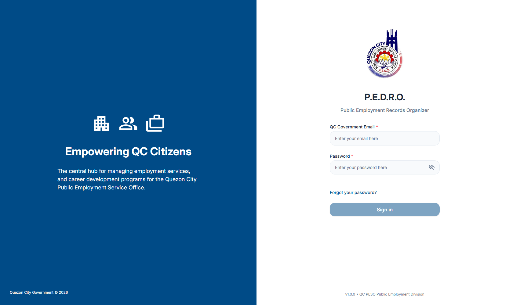

1. Enter your **QC Government Email**.
2. Enter your **Password**.
3. Click **Sign in**.

You can click the eye icon inside the password field to show or hide your password.

**Forgot your password?**

1. Click **Forgot your password?** below the sign-in form.
2. Enter your registered email address.
3. Open the reset link sent to your email and set a new password.

For security, the reset link is time-limited. If you do not receive the email, check your spam folder or ask your administrator to reset your account.

### 2.2 Time In

After signing in, staff with an assigned shift are asked to record their attendance.

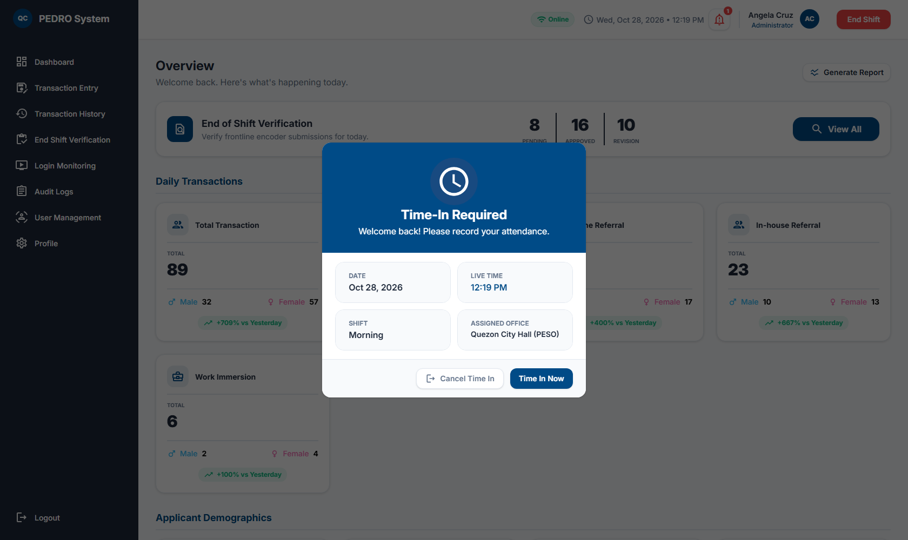

1. Review the displayed **Date**, **Live Time**, **Shift**, and **Assigned Office**.
2. Click **Time In Now** to start your shift.
3. Click **Cancel Time In** if you do not want to start a shift. This signs you out.

You must time in before you can record transactions.

### 2.3 Roles and Access

PEDRO has three user roles. The menu and available actions change based on your role.

| Role                                  | Typical Responsibilities                                                                    |
| ------------------------------------- | ------------------------------------------------------------------------------------------- |
| **Frontline Encoder**                 | Records daily transactions and manages their own encoded records.                           |
| **Administrator (Admin)**             | Verifies staff shifts, monitors logins, manages frontline accounts, and reviews audit logs. |
| **Super Administrator (Super Admin)** | Has full access, including reports, context analytics, user creation, and role changes.     |

| Feature                | Frontline Encoder | Administrator | Super Administrator |
| ---------------------- | :---------------: | :-----------: | :-----------------: |
| Dashboard              |        Yes        |      Yes      |         Yes         |
| Transaction Entry      |        Yes        |      Yes      |         Yes         |
| Transaction History    |        Yes        |      Yes      |         Yes         |
| End Shift Verification |         -         |      Yes      |         Yes         |
| Login Monitoring       |         -         |      Yes      |         Yes         |
| Context Analytics      |         -         |       -       |         Yes         |
| Reports                |         -         |       -       |         Yes         |
| Audit Logs             |         -         |      Yes      |         Yes         |
| User Management        |         -         |    Limited    |         Yes         |
| Profile                |        Yes        |      Yes      |         Yes         |

If a page is not visible in your sidebar, your role does not have access to it. Contact your Super Administrator if you believe you need additional access.

### 2.4 End Your Shift

The **End Shift** button is located in the top-right corner of every page.

1. Click **End Shift**.
2. Review the summary, including **Total Transactions** and **Pending** transactions.
3. Select any relevant **Context Tags** for the shift, such as:
    - Slow Internet
    - Heavy Rain
    - Broken Equipment
    - Applicant Issues
    - Feeling Unwell
    - Broken Software System
4. Add optional remarks about problems or concerns encountered during the shift.
5. Click **Submit & End Shift**.

After ending your shift:

- Transaction Entry and Transaction History are locked for the completed shift.
- Non-Super Administrator users are signed out automatically.
- Your shift is submitted to an Administrator for verification.

**If your shift requires revision**, PEDRO will show the Administrator's remarks the next time you sign in. Review the remarks, make the necessary corrections, and submit the revision.

> **Tip:** End your shift only after all transactions for the day have been recorded. The pending count in the summary helps you confirm this.

### 2.5 Sign Out

1. Click **Logout** at the bottom of the sidebar.
2. Enter a **Reason for Logout**. This field is required.
3. Click **Logout** to confirm.

Always sign out when leaving a shared computer.

---

## 3. Dashboard

The Dashboard gives you a quick view of today's operations and recent activity.

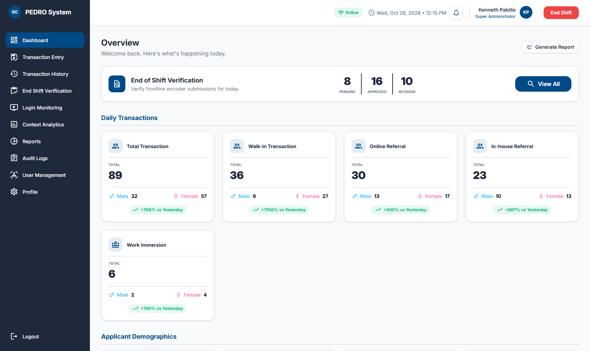

### End of Shift Verification Banner

Administrators and Super Administrators see a summary banner showing the number of **Pending**, **Approved**, and **Revision** shifts for the day. Click **View All** to open the End Shift Verification page.

### Transaction Cards

The dashboard cards are grouped into three sections:

- **Daily Transactions** — Total transactions, walk-in referrals, online referrals, and in-house referrals.
- **Applicant Demographics** — First-time job seekers, PWDs, senior citizens, young workers, and work immersion/internship applicants.
- **Employment Outcomes** — Successful, pending, mismatched, and unclassified transactions.

Each card shows:

- The total for the selected period.
- The male and female breakdown.
- The percentage change versus yesterday.

Click a card to open a details preview showing today's, this week's, and this month's totals, an hourly distribution chart, a demographics chart, and the most active frontline staff for that category.

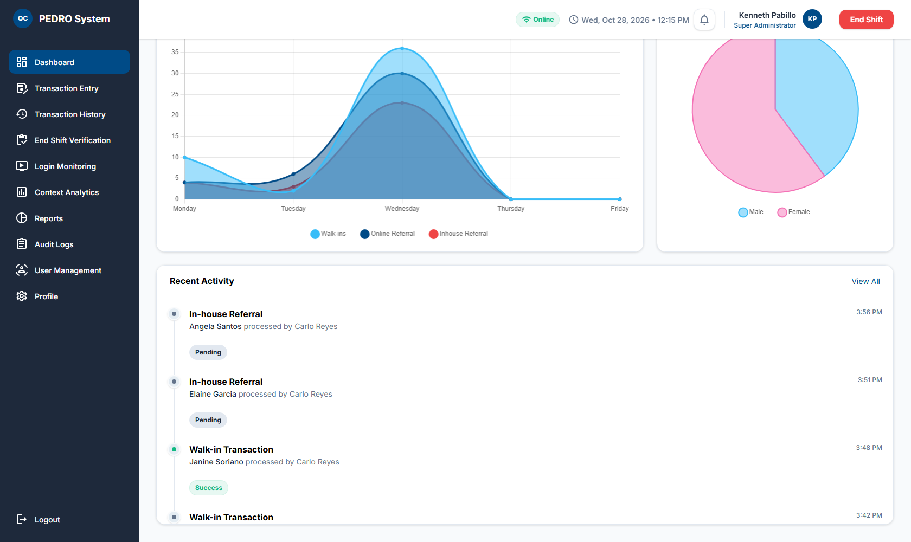

### Charts and Recent Activity

- **Weekly Transaction Volume** — Compares walk-in, online, and in-house referrals over the week.
- **Gender Split** — Shows the male-to-female applicant distribution.
- **Recent Activity** — Lists the latest transactions, the applicant name, the staff member who processed them, the time, and the outcome.

The **Generate Report** shortcut opens the Reports Center for Super Administrators.

---

## 4. Transaction Entry

Use **Transaction Entry** to record a new applicant transaction.

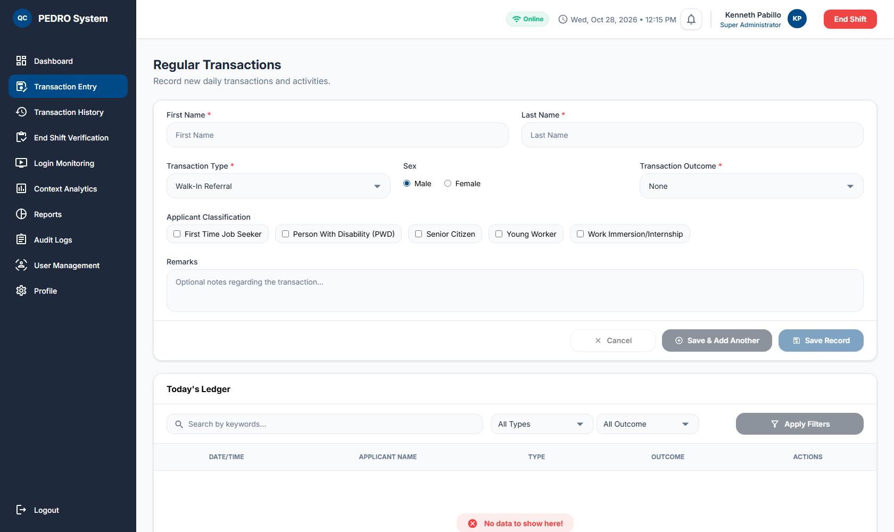

1. Enter the applicant's **First Name** and **Last Name**.
2. Select the **Transaction Type**:
    - Walk-In Referral
    - Online Referral
    - In-house Recruitment
3. Select the applicant's **Sex**.
4. Select the **Transaction Outcome**:
    - None
    - Pending
    - Mismatched
    - Success
5. Select one or more **Applicant Classifications**, if applicable:
    - First Time Job Seeker
    - Person With Disability (PWD)
    - Senior Citizen
    - Young Worker
    - Work Immersion/Internship
6. Add **Remarks** if needed. Remarks are optional.
7. Choose an action:
    - **Save Record** — saves the transaction and returns to the entry page.
    - **Save & Add Another** — saves the transaction and clears the form for the next applicant.
    - **Cancel** — clears the current form without saving.

### Today's Ledger

The lower portion of the page lists the transactions recorded under your current shift. You can:

- Search by keyword.
- Filter by transaction type and outcome.
- Click **Apply Filters** to refresh the list.
- Click **Edit** to update a transaction.
- Click **Delete** to remove a transaction.

All edits and deletions are recorded in the Audit Logs.

> **Note:** Transaction Entry is disabled after you end your shift.

---

## 5. Transaction History

**Transaction History** shows transaction records subject to your role and filters. Frontline Encoders see their own transactions, while Administrators and Super Administrators see all transactions.

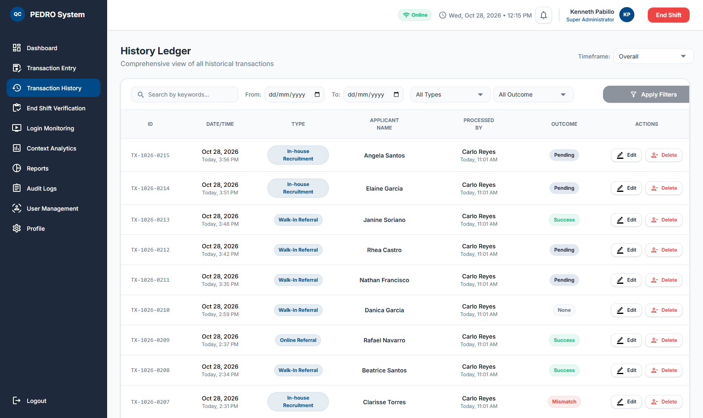

### Filters

- **Timeframe** — Overall, This Day, This Week, This Month, This Year, or Custom.
- **From / To** — Date range for the results.
- **Search** — Search by applicant name, transaction ID, or other keywords.
- **All Types** — Filter by walk-in, online, or in-house referral.
- **All Outcome** — Filter by transaction outcome.

Click **Apply Filters** after changing the filters.

### Table Columns

| Column             | Description                                                                    |
| ------------------ | ------------------------------------------------------------------------------ |
| **ID**             | Unique transaction code.                                                       |
| **Date/Time**      | When the transaction was recorded.                                             |
| **Type**           | Walk-in, online, or in-house referral.                                         |
| **Applicant Name** | Name of the applicant.                                                         |
| **Processed By**   | Staff member who recorded the transaction.                                     |
| **Outcome**        | Success, Pending, Mismatched, or None.                                         |
| **Actions**        | Edit or delete the transaction (Administrators and Super Administrators only). |

Use the pagination controls below the table to move between pages.

> **Note:** Frontline Encoders do not see the Processed By or Actions columns. Editing or deleting a transaction creates an audit log entry.

---

## 6. End Shift Verification

Administrators and Super Administrators use **End Shift Verification** to review and approve daily shift submissions.

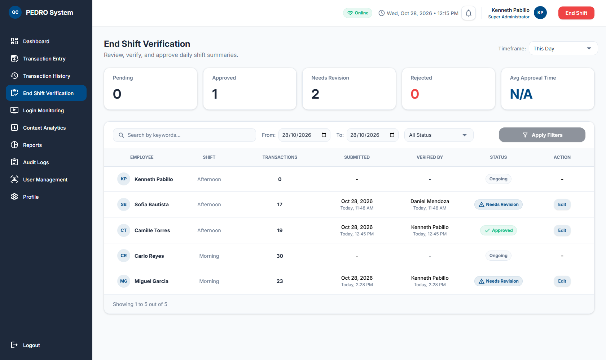

### Summary Cards

- **Pending** — Shifts waiting for review.
- **Approved** — Shifts already approved.
- **Needs Revision** — Shifts returned to staff for correction.
- **Rejected** — Shifts rejected by a verifier.
- **Avg Approval Time** — Average time taken to verify shifts.

### Shift Table

The table shows the employee, shift, number of transactions, submission time, verifier, status, and available action. Use the timeframe and status filters to narrow the list.

Shifts with an **Ongoing** status have no action until the employee ends the shift.

### Reviewing a Shift

Click **Review** or **Edit** on a shift row to open the review window.

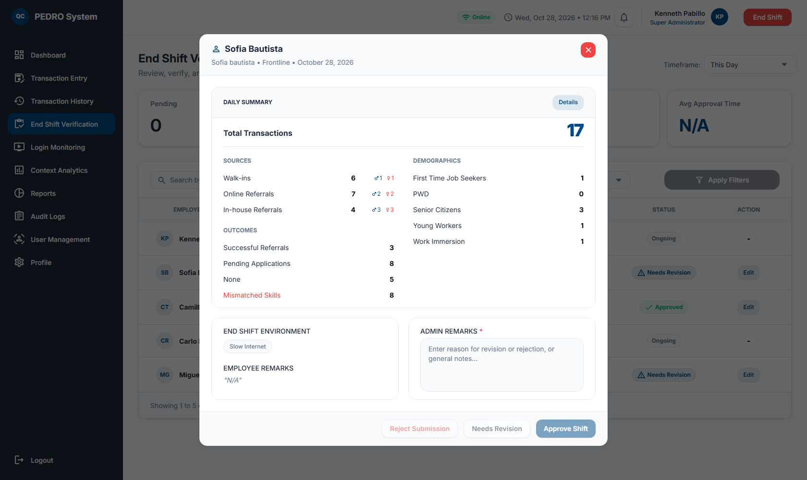

The review window shows:

- **Daily Summary** — Total transactions, sources, outcomes, and applicant demographics.
- **End Shift Environment** — Context tags selected by the employee.
- **Employee Remarks** — Notes submitted by the employee.
- **Admin Remarks** — Required notes from the verifier.

Click **Details** in the Daily Summary to view the individual transactions included in the shift.

Choose one of the following actions:

| Action                | When to Use                                                                  |
| --------------------- | ---------------------------------------------------------------------------- |
| **Approve Shift**     | The shift record is complete and correct.                                    |
| **Needs Revision**    | The employee must correct or resubmit the shift. Admin remarks are required. |
| **Reject Submission** | The shift submission is invalid. Admin remarks are required.                 |

> **Note:** Admin remarks are required before a shift can be approved, returned for revision, or rejected.

---

## 7. Login Monitoring

**Login Monitoring** helps Administrators and Super Administrators track employee attendance and account activity.

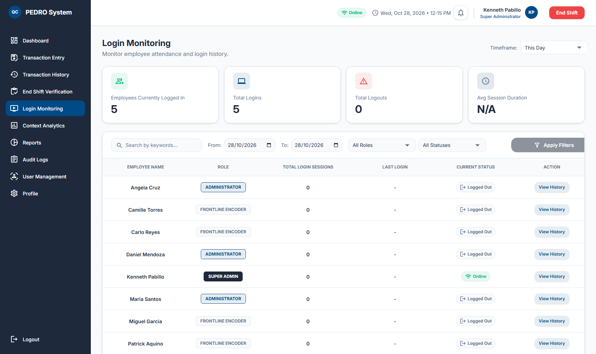

### Summary Cards

- Employees Currently Logged In
- Total Logins
- Total Logouts
- Avg Session Duration

### Employee Table

The table lists each employee's role, total login sessions, last login, current status, and a **View History** button. Use the timeframe, date range, role, and status filters to narrow the list.

Click **View History** to see the employee's session records, including:

- Date
- Time in
- Time out
- Duration
- Logout reason

---

## 8. Context Analytics

**Context Analytics** is a Super Administrator feature that provides AI-assisted analysis of transaction quality and operational conditions.

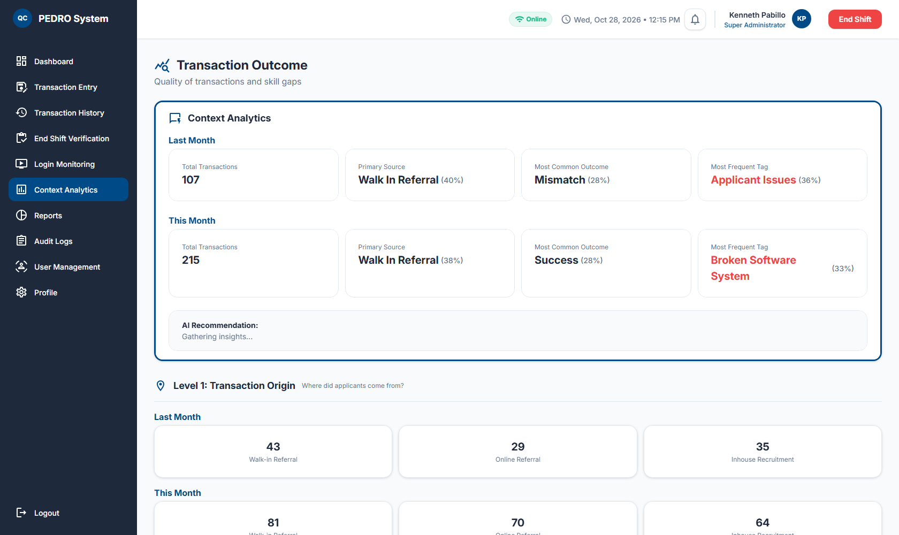

The top section compares **Last Month** and **This Month** for:

- Total transactions
- Primary transaction source
- Most common outcome
- Most frequent environment tag

Below the summary, the page is organized into three levels:

1. **Level 1: Transaction Origin** — Where applicants came from (walk-in, online, or in-house).
2. **Level 2: Transaction Outcome** — Success, pending, mismatch, and none counts by applicant source.
3. **Level 3: Operational Environment** — Frequency of issues such as slow internet, broken equipment, heavy rain, or feeling unwell.

### AI Recommendations

The **AI Recommendation** cards provide a written summary and suggested action for each level. The recommendations are generated by the configured Ollama AI service.

> **Note:** If the AI service is offline or unavailable, the recommendation cards may remain on **"Gathering insights..."**. The rest of the analytics page continues to work normally. Contact your system administrator if the insights do not load after some time.

---

## 9. Reports

The **Reports Center** is available to Super Administrators. It is used to generate and export official QC PESO transaction reports.

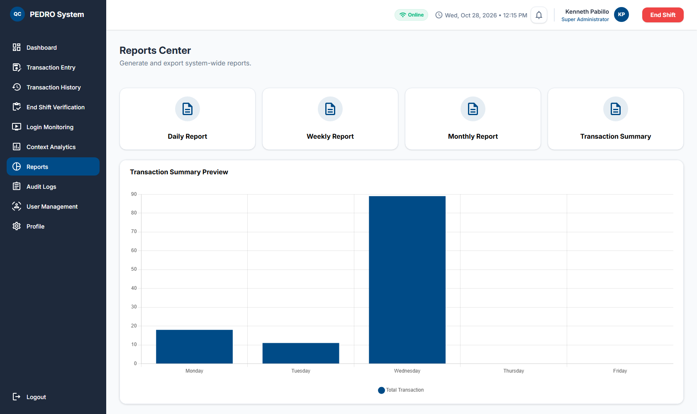

### Report Types

- **Daily Report**
- **Weekly Report**
- **Monthly Report**
- **Transaction Summary**

The page also shows a **Transaction Summary Preview** bar chart of daily transaction volume.

### Previewing and Exporting a Report

1. Click one of the report cards.
2. Review the generated report preview.

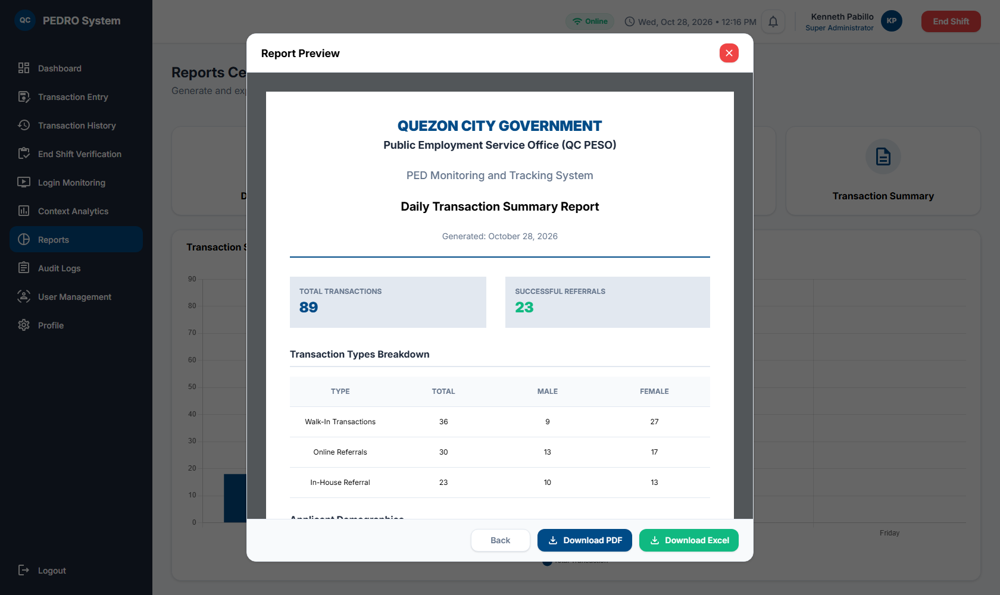

The preview includes:

- Official QC PESO report heading.
- Report type and generation date.
- Total transactions and successful referrals.
- Transaction types breakdown with male and female counts.
- Applicant demographics breakdown.

3. Choose an export option:
    - **Download PDF** — saves the preview as a PDF file.
    - **Download Excel** — saves a formatted spreadsheet.
    - **Back** — closes the preview.

> **Tip:** If your browser blocks the download, allow downloads for the PEDRO site and try again.

---

## 10. Audit Logs

**Audit Logs** record important system activity for accountability and data integrity. This page is available to Administrators and Super Administrators.

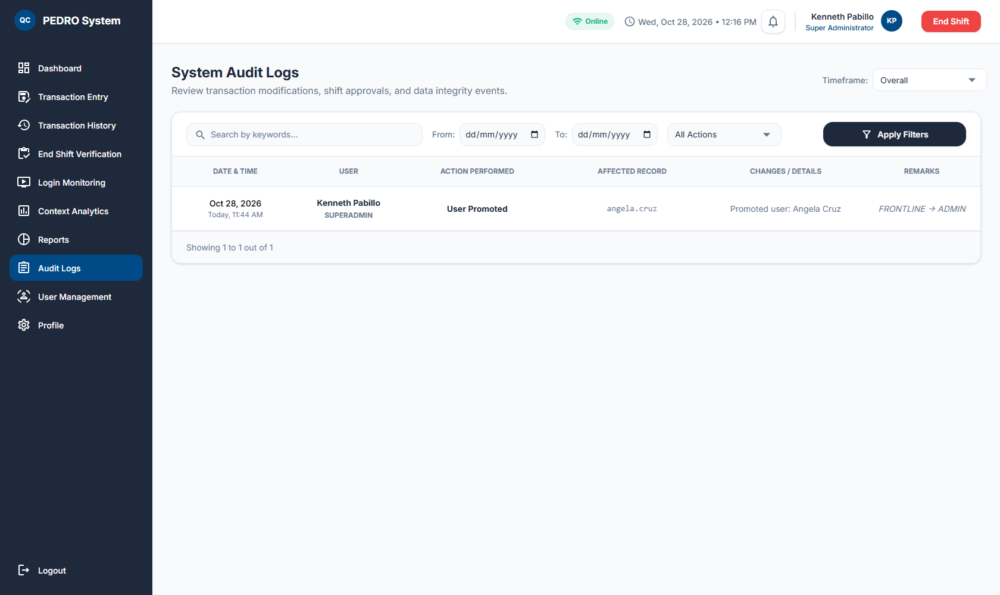

Each log entry shows:

- **Date & Time**
- **User** and role
- **Action Performed**
- **Affected Record**
- **Changes / Details**
- **Remarks**

Use the timeframe, date range, search, and action filters to find specific events. Audit logs include activities such as transaction edits and deletions, shift approvals, user promotions or demotions, account changes, and password resets.

---

## 11. User Management

**User Management** is used to manage employee accounts, roles, and access.

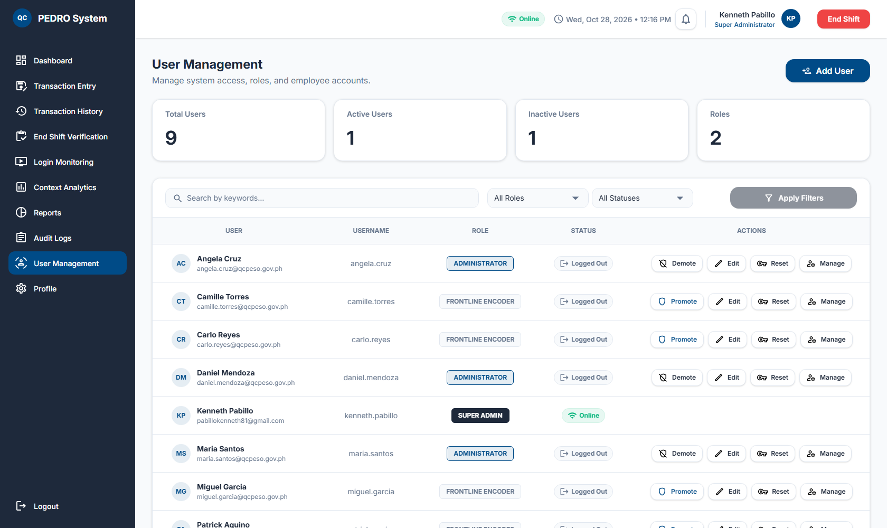

### Summary Cards

- Total Users
- Active Users
- Inactive Users
- Roles

### Adding a User

Super Administrators can click **Add User** to create an account.

1. Enter the user's **First Name** and **Last Name**.
2. Enter the **QC Government Email** and **Username**.
3. Select the **Shift** (None, Morning, or Afternoon).
4. Click **Create User**.

New accounts are created as Frontline Encoders. A temporary password is shown using the format:

```text
QCPESO-FIRSTNAME-LASTNAME-CURRENTDATE
```

For example: `QCPESO-JUAN-DELACRUZ-2026-10-28`. Share the temporary password securely and ask the user to change it after signing in.

### Managing Accounts

Use the search bar and role/status filters to find a user, then choose an action:

| Action      | Description                                         | Who Can Use It                                                    |
| ----------- | --------------------------------------------------- | ----------------------------------------------------------------- |
| **Promote** | Changes a Frontline Encoder to Administrator.       | Super Administrator                                               |
| **Demote**  | Changes an Administrator to Frontline Encoder.      | Super Administrator                                               |
| **Edit**    | Updates the user's name, email, username, or shift. | Administrators (frontline accounts only) and Super Administrators |
| **Reset**   | Resets the user's password.                         | Administrators (frontline accounts only) and Super Administrators |
| **Manage**  | Deactivates, reactivates, or deletes an account.    | Administrators (frontline accounts only) and Super Administrators |

> **Caution:** Deleting an account is permanent and removes its associated data. Deactivate the account instead if the user may return.

Only Super Administrators can manage other Administrators or change roles.

---

## 12. Profile, Preferences, and Notifications

Open **Profile** from the sidebar to view your account information and preferences.

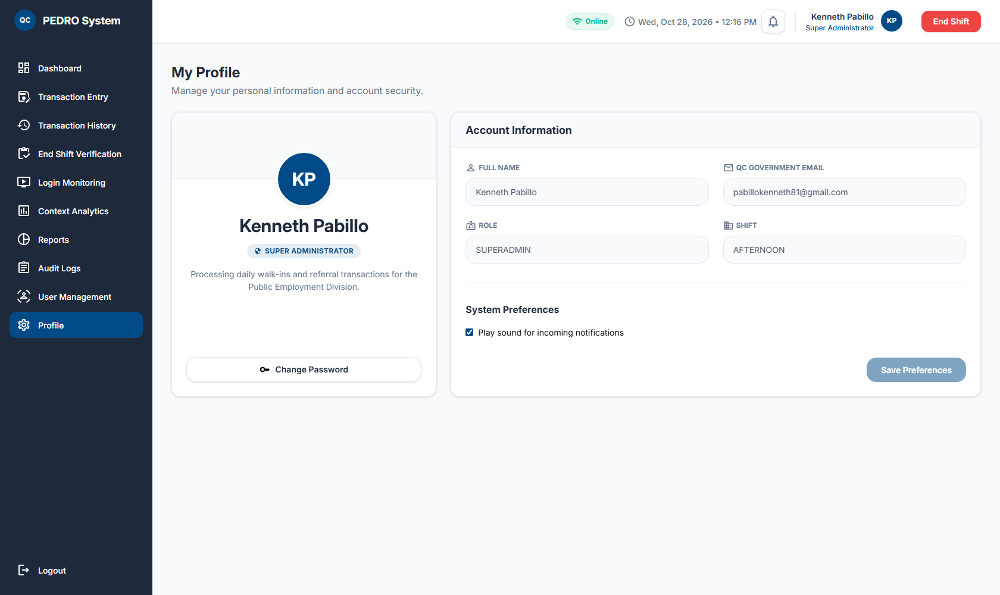

### Account Information

The following fields are read-only:

- Full Name
- QC Government Email
- Role
- Shift

Contact an Administrator if any of these details need to be updated.

### Changing Your Password

1. Click **Change Password**.
2. Enter your **Current Password**.
3. Enter your **New Password** and confirm it.
4. Click **Change Password** to save.

If you do not know your current password, use the **Forgot your password?** link on the sign-in page.

### System Preferences

- **Play sound for incoming notifications** — enables or disables the notification sound.
- Click **Save Preferences** after changing the setting.

### Notifications

The bell icon in the top bar shows new system notifications.

- A red badge indicates the number of unread notifications.
- Click the bell to open the notifications list.
- Unread notifications are marked with a red dot.
- Click **Mark all as read** to clear the unread count.
- Notifications refresh automatically while you are signed in.

Examples of notifications include account role changes, password resets, and other administrative actions.
